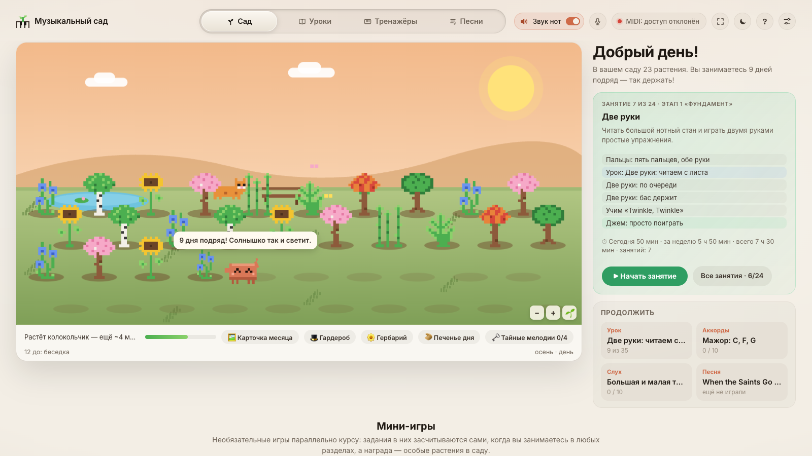
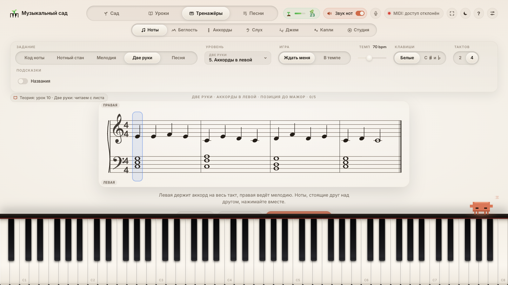
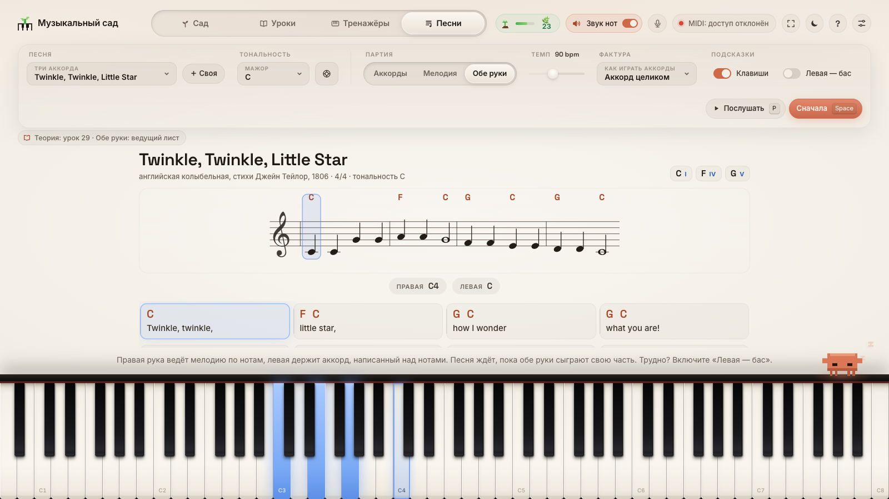
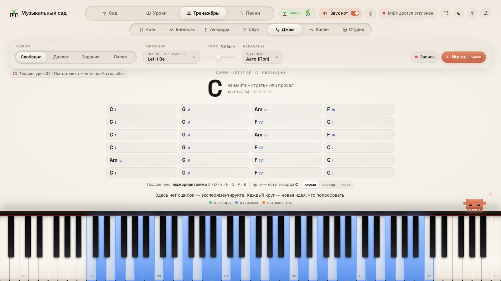

<div align="center">


# Музыкальный сад

**Курс фортепиано для взрослых с MIDI-клавиатурой — занимаетесь, и растёт сад.**

[**▶ Открыть приложение**](https://musical-garden.vercel.app)




</div>

## Что внутри

- 🌱 **Курс из 24 занятий** — три этапа от нот до аккомпанемента двумя руками; секундомер, план шагов и автоотметка заданий.
- 🎹 **Тренажёры** — ноты на стане, чтение с листа двумя руками, беглость, аккорды и последовательности, слух.
- 🎵 **Песни и джем** — ведущий лист «мелодия + аккорды», 67 аккордовых схем, импровизация под грув и лупер.
- 🌻 **Сад** — каждые 10 минут игры вырастает растение; свет следует за часами, ночью падают звёзды, в саду живут садовник Доминик и кот Бемоль.
- 📴 **Работает без интернета** — устанавливается как приложение, прогресс хранится на устройстве.

<table>
  <tr>
    <td></td>
    <td></td>
    <td></td>
  </tr>
  <tr align="center">
    <td>Две руки с листа</td>
    <td>Мелодия и аккорды</td>
    <td>Аккорды песен</td>
  </tr>
</table>

Лучше всего в Chrome или Edge с MIDI-клавиатурой. Без неё — акустическое пианино через микрофон или экранная клавиатура.

## Запуск

```bash
npm install
npm run dev    # http://localhost:5173
npm test       # тесты Vitest
```

Каждый пуш в `main` публикуется на Vercel.

<sub>Звук рояля — Salamander Grand Piano, Alexander Holm, [CC BY 3.0](https://creativecommons.org/licenses/by/3.0/).</sub>
